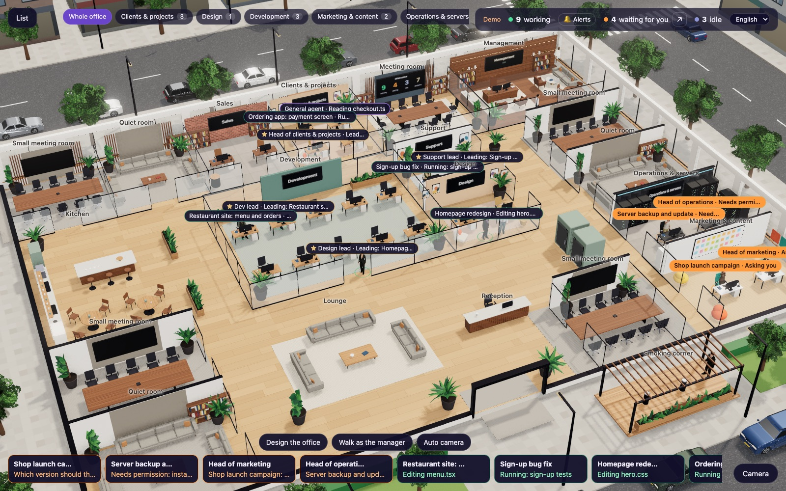
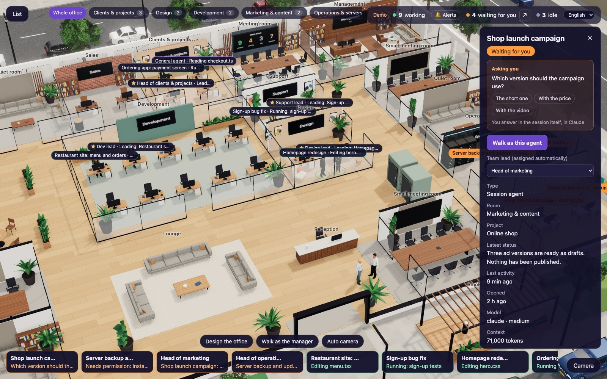

# Agentloft

A live 3D office for your Claude Code sessions and agents. Website and live demo: https://edensitko.github.io/agentloft/

Every open session is a person in the office. Whoever is working sits at a desk and types, whoever waits for you
waves, and whoever is idle wanders off for coffee. Sessions are grouped into departments, each with a team lead, so
one look tells you what is running, what is stuck, and what is waiting for your answer.

It runs on your own machine, reads only what Claude Code already keeps there, and sends nothing anywhere.



## What you get

**A live picture of your sessions and agents.** Status comes from Claude Code's own files and updates within a
couple of seconds: working, waiting for you, or idle. Subagents appear next to the session that started them.

**What each waiting agent needs.** A question with its choices, a plan to approve, a tool call that needs
permission, or a decision at the end of a turn. One button jumps to that session, in the Claude app or, when
Remote Control is on, in the browser. The office never approves anything itself.



**Meetings that produce a summary.** Call a team to the meeting room and the panel turns into a status report:
who waits for you and for how long, who works on what, which sessions have grown too large or gone stale, and
where every idle session stands. The text comes from each session's own last recap, and can be copied.

**A company you design.** Departments, team leads, and rules that decide which lead is responsible for each
session. Start from one of five templates, connect roles to your own Claude agents, save the whole office under a
name and come back to it later.

**Complete offices.** Six ready-made offices set everything in one choice: the building and its floor plan, the company, the look of every room, the
furniture, the light, and what is outside the windows (a city, a green campus, a suburb, a beach or mountains).

**Eight languages.** English, Spanish, French, German, Portuguese, Russian, Hebrew and Arabic, including right to left.
The language follows your browser and can be changed in Settings. Adding one is a dictionary under `public/locales/`, a
line in `public/i18n.js`, and a file under `docs/lang/` for the website; a test checks that nothing is missing.

**A visual editor.** Furniture and plants, eleven room templates, colours, lighting and time of day, and a
custom look for every person.

**Walk around.** Become the manager and walk through the office in third person. Walk up to someone to open
their session or hand them a task.

**Notifications.** A system notification, once, when a session starts waiting for you.

## Try it without Claude

The demo runs a made-up studio with made-up sessions and never saves anything:

```bash
npm install
```

```bash
npm start
```

Then open `http://localhost:4455/?demo`. Add `=waiting`, `=meeting`, `=editor` or `=walk` to land on one scene,
for example `http://localhost:4455/?demo=meeting`. Add `&office=startup`, `campus`, `studio`, `classic`, `night` or
`cabin` to see a complete office, and `&lang=de` (or any other language) to change the language.

## Install

You need Node.js 22 or newer (developed and tested on Node 24) and Claude Code, on macOS, or on Windows or Linux as an
experiment (see Limits).

```bash
git clone https://github.com/edensitko/agentloft.git
```

```bash
cd agentloft && npm install
```

```bash
npm start
```

Open `http://localhost:4455`. On a fresh install a welcome screen lets you pick an office to start from. Press "Design the office" and open the "Company" tab to make it yours.

To keep it running in the background and start it at login:

```bash
scripts/install-macos.sh
```

```bash
scripts/install-macos.sh uninstall
```

On Linux use `scripts/install-linux.sh` (systemd). On Windows:

```powershell
powershell -ExecutionPolicy Bypass -File scripts\install-windows.ps1
```

Set `PORT` to use a port other than 4455.

## Privacy and safety

The office is a viewer. This is everything it touches.

**It reads, from your home folder:**

| Path | What for |
| --- | --- |
| `~/.claude/sessions/*.json` | which sessions are open and their status |
| `~/.claude/projects/**/<session>.jsonl` | the last 512 KB of each open session's transcript: its current task, the tool it is running, its last recap, and what it is waiting for |
| `~/.claude/projects/**/subagents/` | running subagents |
| `~/.claude/agents/*.md` | the name and description of your agents (frontmatter only) |
| `~/.chums/` | Chums, if you use them |

**It never shows a command.** For a shell command only its description is shown, because the command itself may
hold a secret. Text that looks like a key or a token is masked before it leaves the server. Key files are never read.

**It writes only to `data/`**, next to the code: `layout.json` (your design), `company.json` (your company),
`templates/` (offices you saved), and `backups/` (a copy for each of the last seven days something changed, which Settings can
restore). That folder is git-ignored, so nothing personal ends up in a commit.

**It listens on `127.0.0.1` only.** Write requests must come from the page itself (same origin), so another site
open in your browser cannot change your office.

**It cannot act for you.** There is no endpoint that answers a session, approves a permission or runs anything
on your behalf. The only thing the page can stop is the office's own server (Settings, on this machine only).
Opening a session and sending a task are links to the Claude app, which you confirm there.

### Viewing it from another device

The supported way is [Tailscale Serve](https://tailscale.com/kb/1312/serve), which keeps it inside your own
tailnet. Start the server with two variables, so that it accepts requests only for that host and only from you:

```bash
OFFICE_HOST=<your-machine>.<your-tailnet>.ts.net:4455 OFFICE_USER=<your-tailscale-login> npm start
```

Do not put it behind Tailscale Funnel or any other public address. Requests that arrive through Funnel are refused.

## Making it yours

Everything is done in the editor ("Design the office"), and saved on your machine.

- **Company tab.** Pick a template (small team, solo, digital studio, product company, full company), name the
  company, add and remove departments and roles, and choose which of your Claude agents fills each role. The rules
  list decides who leads a session: a session whose name or project contains one of the words goes to that lead,
  and the first rule that matches wins.
- **My templates.** Save the company and the design under a name. Up to thirty are kept.
- **Rooms tab.** Rename a room, move it to another place on the floor, and choose its template, colour and floor.
- **Agents tab.** A custom look for every person: body, clothes, hair, skin tone, height.
- **Items and atmosphere.** Furniture, plants, signs, lighting and time of day.

`data/company.json` can also be edited by hand; it is validated every time it is read, and a broken file falls
back to the default template instead of breaking the office.

## How it works

A small Node.js server with no dependencies of its own reads the files above every second and a half, and pushes
the result to the page over Server-Sent Events. The page draws the office with [three.js](https://threejs.org).

```
server/collector.js   reads sessions, transcripts, agents; redacts; builds the list of workers
server/company.js     your company file, validated
server/templates.js   your saved offices
server/layout.js      your design, validated
server/notify.js      who just started waiting
server/backup.js      daily copies of your own files
server/platform.js    what differs between macOS, Windows and Linux
server/index.js       HTTP, events, access checks
public/company.js     who leads what: rules, departments, leads mirroring their sessions
public/app.js         the page: floor, people, panels, camera
public/people.js      the people: avatars, animation, activities
public/world.js       the building, rooms and furniture
public/editor.js      the visual editor
public/plans.js       floor plans
public/city.js        the world outside
public/i18n.js        languages; dictionaries are in public/locales/
```

```bash
npm test
```

## Limits

- Windows and Linux are experimental. The tests run on both and the Windows installer is exercised in CI, but notifications,
  the links to the Claude app, and reading a real Claude Code install have only been used on macOS.
- The translations other than English and Hebrew were made by machine and need a native reader. Text that a session wrote itself stays in its own language.
- Opening a session and sending a task need the Claude desktop app on the same machine. From another device,
  only sessions with Remote Control turned on can be opened.
- A meeting, and gathering a team into a room, are a view. They reset when the page is reloaded.
- A floor plan has between four and fifteen rooms. Departments beyond that share one.
- Changing the floor plan reloads the page, so it cannot be undone with the Undo button. Choosing a complete office saves the
  current one under My templates first.

## Credits

The people are from the [Microsoft Rocketbox Avatar Library](https://github.com/microsoft/Microsoft-Rocketbox)
(MIT License, Copyright © Microsoft Corporation). See `THIRD-PARTY-NOTICES.md`.

Agentloft is not made by, affiliated with or endorsed by Anthropic. Claude and Claude Code are Anthropic's names, used here only
to say what it works with.

## License

MIT. See `LICENSE`.
